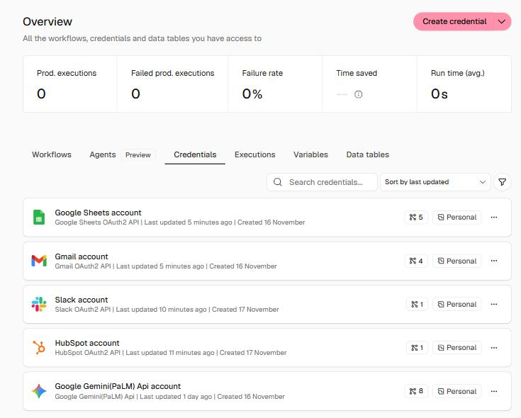

# Checkpoint 4 – Integraciones: HubSpot · Gmail · Slack

**Alumno:** Leonel Rojas
**Archivo:** `checkpoint4_leonel_rojas.json`
**Workflow en n8n:** M4 - Manager - Integraciones CRM · Gmail · Slack

Este checkpoint parte del Manager con memoria del Módulo 3. Le sumé una segunda puerta de entrada, la casilla de Gmail, y conecté el agente con tres herramientas reales por OAuth2: **HubSpot** como CRM, **Gmail** como casilla de soporte y **Slack** como canal del equipo (#operaciones). El chat del M3 sigue funcionando igual. Cuando el mensaje entra por email, al final pasa además por el CRM, el borrador y el aviso al equipo.

## Credenciales conectadas (OAuth2)



Las tres del proyecto son **HubSpot account**, **Gmail account** y **Slack account**, todas con OAuth2. Google Sheets y Gemini vienen de los módulos anteriores (memoria y modelo).

## Cómo funciona

```
Gmail Trigger (no leídos, -from:me)
   │
① IF anti auto-reply ── Sí ─▶ Stop (corta el bucle)
   │ No
Extraer datos del email → [Memoria M3 → Router IA → Workers M2] → Guardar memoria
   │
¿Canal email?
   │
④ Set: limpia y valida el payload ── inválido ─▶ Descartar (evita el 400)
   │
② Look up en HubSpot (buscar contacto por email)
   ├── existe ──▶ Actualizar contacto
   └── no existe ─▶ Crear contacto        (evita el 409)
   │
③ Gmail: Create Draft (Human-in-the-loop)
   │
Set: payload mínimo → Slack #operaciones
```

### Los 4 controles que pide la consigna

1. **① IF anti auto-reply.** Va justo después del Gmail Trigger y descarta el mail si:
   - el asunto contiene *auto-reply*, *automatic reply*, *respuesta automática*, *out of office*, *fuera de la oficina*, *undeliverable*, *delivery status notification* o *mail delivery*;
   - el remitente es *no-reply*, *noreply*, *mailer-daemon*, *postmaster* o la propia casilla;
   - o el mail trae los headers `Auto-Submitted` o `Precedence: bulk/auto_reply`.

   Además, el trigger ya filtra `-from:me`, así que los mails de log que manda el propio sistema no vuelven a entrar.
2. **② Look up antes del Create.** Busco el contacto en HubSpot por email. Si existe lo actualizo, y si no existe lo creo. Así no se duplican contactos (error 409).
3. **③ Create Draft.** La respuesta de la IA nunca se envía sola. Queda como borrador en el mismo hilo de Gmail y alguien del equipo la revisa antes de mandarla (Human-in-the-loop).
4. **④ Set de limpieza.** Antes del CRM dejo solo `email`, `nombre`, `empresa`, `asunto`, `categoría`, `estado` y la respuesta. Valido el email con una regex y, si es inválido o está vacío, el flujo se corta (evita el error 400). Para Slack hay otro Set que arma un único texto corto, sin binarios ni objetos pesados.

## Mínimo privilegio

| Herramienta | Qué lee | Qué escribe | Campos que toca |
|---|---|---|---|
| HubSpot | Busca un contacto por email (límite 1) | Crea o actualiza **solo contactos** | email, firstname, lastname, company, lifecycle stage |
| Gmail | Mails no leídos de la bandeja (sin promociones ni social) | Solo **borradores** (nunca envía) | destinatario, asunto, cuerpo y thread |
| Slack | No lee nada | Publica en **un solo canal**: #operaciones | un texto plano |

Los permisos los limité desde el diseño del flujo: cada nodo usa una sola operación y los campos justos. Los scopes OAuth son los que n8n Cloud pide por defecto para cada app; en producción se podrían recortar más con una app OAuth propia.

## Prueba de regresión

Mandé un mail de prueba desde otra casilla (Martina Ríos, Distribuidora Andes SRL, consulta por automatizar facturas):

| Corrida | Resultado |
|---|---|
| 1ª | El IF lo dejó pasar porque no es auto-reply. El router lo clasificó como VENTAS y el Worker lo calificó. El **Look up no encontró** el contacto, así que se **creó** en HubSpot y quedó el **borrador** en Gmail. Slack falló porque todavía no existía el canal. |
| 2ª | Mismo mail. El **Look up encontró** el contacto, así que se **actualizó** sin duplicarlo. Se creó el borrador y el **aviso llegó a #operaciones**. Todo en verde. |

## Cómo importarlo

En n8n: **Workflows → Import from File** y elegís `checkpoint4_leo_rojas.json`. Después hay que asignar tus propias credenciales de HubSpot, Gmail, Slack, Google Sheets y Gemini, y apuntar los nodos *Execute Workflow* a tus Workers del M3.
